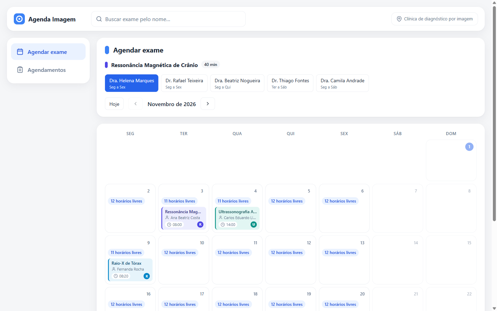
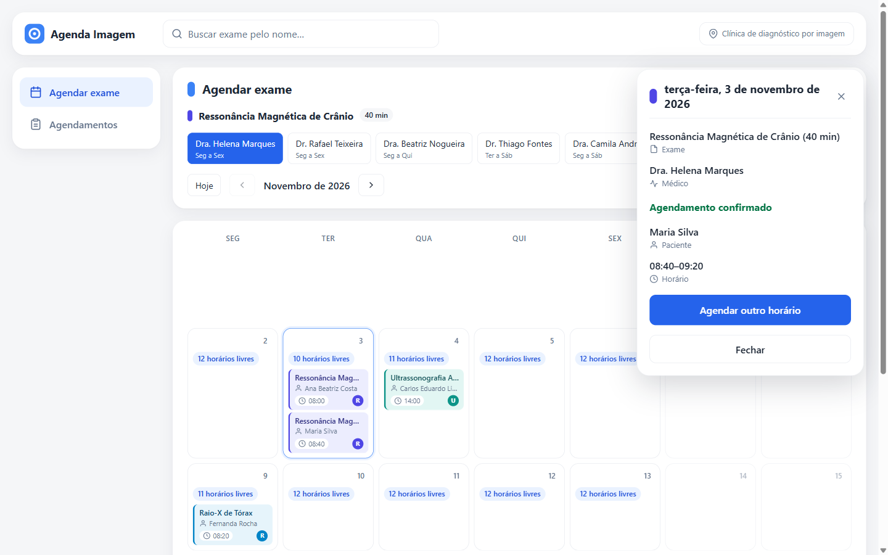
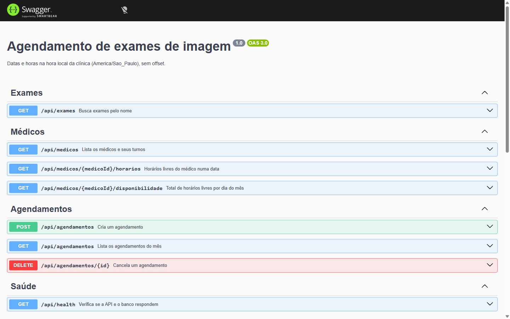

# Agendamento de Exames de Imagem

[](https://github.com/mathfrancisco/desafio-tecnico-agendamento-exames/actions/workflows/ci.yml)

Aplicação full-stack para buscar um exame, ver no calendário os dias e
horários livres de um médico, agendar e cancelar. Back-end em NestJS com
Clean Architecture, front-end em React + Vite, num monorepo.

**Demo:** https://p01--agenda-imagem--4cj5fhqhqb2r.code.run
(Swagger em [/api/docs](https://p01--agenda-imagem--4cj5fhqhqb2r.code.run/api/docs)).
Hospedado no plano gratuito do Northflank: o banco não tem volume persistente,
então os agendamentos da demo somem a cada novo deploy.

O enunciado original está em [docs/desafio.md](docs/desafio.md).

## Demonstração


Gravado na demo: busca "ressonancia", escolhe a Dra. Helena Marques, abre o
dia 3, agenda às 08:40 para Maria Silva, vê o exame na tela Agendamentos e
cancela.

| Agendar exame: dias com vaga | Escolher horário e paciente |
| --- | --- |
|  |  |
| **Confirmação** | **Agendamentos do mês** |
|  |  |
| **Detalhe e cancelamento** | **Swagger (`/api/docs`)** |
|  |  |

| Celular: Agendar | Celular: Agendamentos |
| --- | --- |
|  |  |

## Documentação

| Documento | Conteúdo |
| --- | --- |
| [01 — Tecnologias](docs/01-tecnologias.md) | Stack, versões, arranjo do repositório e porquês |
| [02 — Arquitetura](docs/02-arquitetura.md) | Módulos, camadas, erros, controle de concorrência |
| [03 — Modelagem de dados](docs/03-modelagem-dados.md) | Entidades, schema SQLite, contrato da API |
| [04 — Regras de negócio](docs/04-regras-negocio.md) | Regras do enunciado e premissas adotadas |
| [05 — Planejamento](docs/05-planejamento.md) | Specs quebradas em cards, com critérios de aceite |
| [06 — Deploy](docs/06-deploy.md) | Imagem Docker única e passo a passo no Northflank |

## Pré-requisitos

- Node.js 20 ou superior (testado em 24) e npm.
- Nada mais: o banco é SQLite em arquivo, criado na primeira execução.

## Como rodar

Em dois terminais, a partir da raiz do repositório.

**1. API (porta 3000)**

```bash
cd backend
npm install
npm run start:dev
```

A API sobe em `http://localhost:3000/api`. Documentação Swagger em
`http://localhost:3000/api/docs` e health check em `/api/health`.
Variáveis opcionais:

| Variável | Padrão | Uso |
| --- | --- | --- |
| `PORT` | `3000` | Porta HTTP |
| `DB_PATH` | `agendamentos.db` | Arquivo SQLite (relativo a `backend/`) |
| `EXAMES_CSV_PATH` | `../dados/exames.csv` | Catálogo de exames |

**2. Front-end (porta 5173)**

```bash
cd frontend
npm install
npm run dev
```

Abra `http://localhost:5173`. O Vite encaminha `/api` para
`http://localhost:3000`, então a API precisa estar rodando nessa porta.

## Testes

```bash
cd backend
npm test            # unitários: domínio, use cases com ports falsos, adapters (100)
npm run test:e2e    # rotas HTTP, incluindo 10 pedidos concorrentes (89)
npm run test:all    # os dois
```

```bash
cd frontend
npm test            # componentes, utilitários e cliente da API (108)
```

A CI (GitHub Actions) roda lint, build e todos os testes das duas pontas em
cada push e pull request.

## Requisições da API, passo a passo

Todas as rotas começam com `/api` e trocam JSON. Datas e horas são sempre a
hora local da clínica (`America/Sao_Paulo`), sem fuso no texto:

| Tipo | Formato | Exemplo |
| --- | --- | --- |
| Data | `YYYY-MM-DD` | `2027-03-02` |
| Mês | `YYYY-MM` | `2027-03` |
| Data e hora | `YYYY-MM-DDTHH:mm` | `2027-03-02T08:40` |

Para testar, escolha a base (local ou a demo) e copie os comandos:

```bash
API=http://localhost:3000/api
# ou: API=https://p01--agenda-imagem--4cj5fhqhqb2r.code.run/api
```

### Visão geral

As rotas aparecem na ordem em que a tela as usa.

| # | Método e rota | Para quê | Sucesso |
| --- | --- | --- | --- |
| 1 | `GET /exames?nome=` | Buscar o exame pelo nome | 200 |
| 2 | `GET /medicos` | Listar médicos e dias de atendimento | 200 |
| 3 | `GET /medicos/{id}/disponibilidade?mes=&exameId=` | Contar vagas por dia do mês (calendário) | 200 |
| 4 | `GET /medicos/{id}/horarios?data=&exameId=` | Listar horários livres de um dia | 200 |
| 5 | `POST /agendamentos` | Agendar | 201 |
| 6 | `GET /agendamentos?mes=&medicoId=` | Listar os agendamentos do mês | 200 |
| 7 | `DELETE /agendamentos/{id}` | Cancelar | 204 |
| 8 | `GET /health` | Saber se a API e o banco respondem | 200 |

Todo erro tem o mesmo formato. Em erro de validação (400), `message` é uma
lista com um texto por campo.

```json
{ "statusCode": 404, "error": "Not Found", "message": "Exame 999 não encontrado" }
```

| Código | Significa |
| --- | --- |
| 400 | Dado inválido: formato errado, campo faltando, id que não é número inteiro |
| 404 | Exame, médico ou agendamento não existe |
| 409 | Horário já ocupado |
| 422 | Dado válido, mas a regra não permite: horário no passado, fora do expediente ou exame que já começou |

### 1. Buscar exames: `GET /exames?nome=`

**Para quê:** achar o exame enquanto o paciente digita na barra de busca.

**Como funciona:** procura o trecho em qualquer parte do nome, sem diferenciar
maiúsculas nem acentos: "ressonancia" acha "Ressonância". Sem `nome`, devolve
os 30 exames. A `duracaoMinutos` (20, 30 ou 40) define o tamanho de cada
horário na agenda.

```bash
curl "$API/exames?nome=ressonancia"
```

```json
[
  { "id": 22, "nome": "Ressonância Magnética de Coluna Lombar", "duracaoMinutos": 40 },
  { "id": 20, "nome": "Ressonância Magnética de Crânio", "duracaoMinutos": 40 }
]
```

**Erro:** `nome` repetido na URL (`?nome=a&nome=b`) dá 400.

### 2. Listar médicos: `GET /medicos`

**Para quê:** mostrar os botões de médico e os dias em que cada um atende.

**Como funciona:** cada médico traz os turnos da semana. Um dia pode ter dois
turnos (manhã e tarde).

```bash
curl "$API/medicos"
```

```json
[{
  "id": 1, "nome": "Dra. Helena Marques", "crm": "CRM-MG 11111",
  "turnos": [
    { "dia": "SEG", "inicio": "08:00", "fim": "12:00" },
    { "dia": "SEG", "inicio": "14:00", "fim": "18:00" }
  ]
}]
```

### 3. Vagas por dia do mês: `GET /medicos/{id}/disponibilidade?mes=&exameId=`

**Para quê:** montar o calendário. Cada dia mostra "N horários livres".

**Como funciona:** aplica a cada dia do mês a mesma regra da rota 4 e devolve
só a contagem. Dia sem expediente ou que já passou vem com `livres: 0`.

```bash
curl "$API/medicos/1/disponibilidade?mes=2027-03&exameId=20"
```

```json
{
  "medicoId": 1, "exameId": 20, "mes": "2027-03",
  "dias": [
    { "data": "2027-03-01", "livres": 12 },
    { "data": "2027-03-06", "livres": 0 }
  ]
}
```

**Erros:** médico ou exame inexistente dá 404. `mes` ou `exameId` inválido dá 400.

### 4. Horários livres de um dia: `GET /medicos/{id}/horarios?data=&exameId=`

**Para quê:** mostrar os botões de horário quando o paciente abre um dia.

**Como funciona:** a grade começa no início de cada turno e avança pela
duração do exame. Um exame de 40 min às 08:00 gera 08:00, 08:40, 09:20 e assim
por diante. Saem da lista os horários que cruzam um agendamento existente e,
hoje, os que já passaram.

```bash
curl "$API/medicos/1/horarios?data=2027-03-02&exameId=20"
```

```json
{
  "medicoId": 1, "exameId": 20, "data": "2027-03-02",
  "horarios": [
    { "inicio": "08:00", "fim": "08:40" },
    { "inicio": "08:40", "fim": "09:20" }
  ]
}
```

Dia sem expediente, data passada ou agenda cheia devolvem `horarios: []` com
200. Não é erro: só não há vaga.

**Erros:** médico ou exame inexistente dá 404. `data` ou `exameId` inválido dá 400.

### 5. Agendar: `POST /agendamentos`

**Para quê:** confirmar um horário em nome do paciente.

| Campo | Regra |
| --- | --- |
| `pacienteNome` | 3 a 100 caracteres, sem quebra de linha nem caractere de controle. Espaços nas pontas são removidos |
| `exameId` | Id de um exame (rota 1) |
| `medicoId` | Id de um médico (rota 2) |
| `inicio` | Um dos horários da rota 4, no formato `YYYY-MM-DDTHH:mm` |

```bash
curl -X POST "$API/agendamentos" \
  -H "Content-Type: application/json" \
  -d '{"pacienteNome":"Maria Silva","exameId":20,"medicoId":1,"inicio":"2027-03-02T08:00"}'
```

Resposta 201. A API calcula o `fim` a partir da duração do exame:

```json
{
  "id": 1, "pacienteNome": "Maria Silva", "exameId": 20, "medicoId": 1,
  "inicio": "2027-03-02T08:00", "fim": "2027-03-02T08:40",
  "criadoEm": "2026-11-02T01:42:28.000Z"
}
```

**Erros:**

| Código | Quando | Exemplo de `message` |
| --- | --- | --- |
| 400 | Campo inválido | `["pacienteNome deve ter entre 3 e 100 caracteres"]` |
| 404 | Exame ou médico não existe | `Exame 999 não encontrado` |
| 409 | Horário já ocupado, inclusive por outro pedido no mesmo instante | `Horário indisponível para este médico` |
| 422 | Horário que já passou | `Não é possível agendar em data e hora que já passaram` |
| 422 | Fora do expediente ou fora da grade (08:30 num exame de 40 min) | `Horário fora do expediente ou fora da grade do médico para este exame` |

Para ver cada erro:

```bash
# 409: repita o mesmo POST acima

# 422: domingo, sem expediente
curl -X POST "$API/agendamentos" \
  -H "Content-Type: application/json" \
  -d '{"pacienteNome":"Maria Silva","exameId":20,"medicoId":1,"inicio":"2027-03-07T08:00"}'

# 400: nome curto, id zero e data inválida
curl -X POST "$API/agendamentos" \
  -H "Content-Type: application/json" \
  -d '{"pacienteNome":"Al","exameId":0,"medicoId":1,"inicio":"amanha"}'
```

### 6. Agendamentos do mês: `GET /agendamentos?mes=&medicoId=`

**Para quê:** montar a tela Agendamentos.

**Como funciona:** devolve os agendamentos do mês em ordem de início.
`medicoId` é opcional e filtra por médico.

```bash
curl "$API/agendamentos?mes=2027-03"
curl "$API/agendamentos?mes=2027-03&medicoId=1"
```

A resposta é uma lista no mesmo formato da resposta 201 da rota 5.

**Erros:** `mes` ausente ou inválido dá 400. Médico inexistente no filtro dá 404.

### 7. Cancelar: `DELETE /agendamentos/{id}`

**Para quê:** desmarcar um exame que ainda não começou. O horário volta a
aparecer nas rotas 3 e 4.

```bash
curl -i -X DELETE "$API/agendamentos/1"
```

Resposta 204, sem corpo.

**Erros:** `id` que não é inteiro dá 400. Agendamento inexistente dá 404.
Exame que já começou ou passou dá 422.

### 8. Health check: `GET /health`

**Para quê:** saber se a API e o banco respondem. O Northflank usa esta rota
para decidir se o container está pronto.

```bash
curl "$API/health"
```

Responde `{ "status": "ok" }` (200). Se o banco não responder:
`{ "status": "erro" }` (503).

O contrato completo, com todos os casos, está em
[docs/03-modelagem-dados.md](docs/03-modelagem-dados.md) e no Swagger em `/api/docs`.

## Decisões de arquitetura (resumo)

- **Monorepo** `backend/` + `frontend/`: um clone, histórico único, contrato da
  API versionado junto com quem o consome.
- **Clean Architecture** no back-end: `domain` (regras puras) ←
  `application` (um use case por arquivo + ports) ← `infrastructure`
  (SQLite, CSV, relógio) e `http` (controllers Nest). O `app.module.ts` é a
  única raiz de composição. A regra de dependência é verificada pelo ESLint:
  importar Nest ou SQLite no domínio quebra o lint e a CI.
- **Núcleo puro**: `gerarHorarios` concentra RN2/RN4 e é usado por
  `/horarios`, `/disponibilidade` e pela validação do `POST`, então a API
  aceita exatamente o que oferece e as regras não divergem.
- **Relógio como port** (`Clock`): regra "sem passado" testável com hora fixa.
- **SQLite (better-sqlite3)**: zero instalação; um trigger `BEFORE INSERT`
  barra intervalos sobrepostos no próprio banco, então nem pedidos simultâneos
  nem um segundo processo geram agendamento duplicado (há teste com 10 pedidos
  simultâneos e com duas conexões ao mesmo arquivo). WAL ligado para leituras
  não esperarem escritas.
- **Catálogos em memória**: exames lidos do CSV fornecido; médicos declarados
  em código a partir de `dados/medicos.md`.
- **Vite** no front: build simples e proxy para a API; sem SSR, sem roteador,
  sem biblioteca de estado nem UI kit (YAGNI). Calendário mensal com
  horários livres por dia, painel lateral para agendar/cancelar, cor por
  modalidade de exame e layout em lista no celular.
- **Swagger** em `/api/docs`, **health check** em `/api/health` e **CI** no
  GitHub Actions.

Detalhes em [docs/02-arquitetura.md](docs/02-arquitetura.md).

## Premissas

- Fuso único `America/Sao_Paulo`; a API troca hora local sem offset
  (`YYYY-MM-DDTHH:mm`).
- O `inicio` de um agendamento precisa estar na grade gerada a partir do
  início do turno.
- Data passada ou dia sem turno na consulta de horários retornam lista vazia.
- Nome do paciente obrigatório, 3 a 100 caracteres, sem quebra de linha nem
  caracteres de controle.

Lista completa em [docs/04-regras-negocio.md](docs/04-regras-negocio.md).

## O que ficou de fora (próximos passos)

- Autenticação e cadastro de pacientes.
- Remarcação.
- Feriados, bloqueios e pausas na agenda.
- Postgres com `EXCLUDE USING gist` para rodar várias instâncias da API.
- Testes de ponta a ponta na interface (Playwright).
