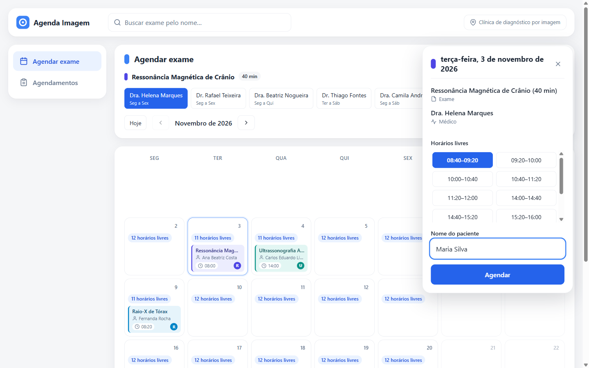
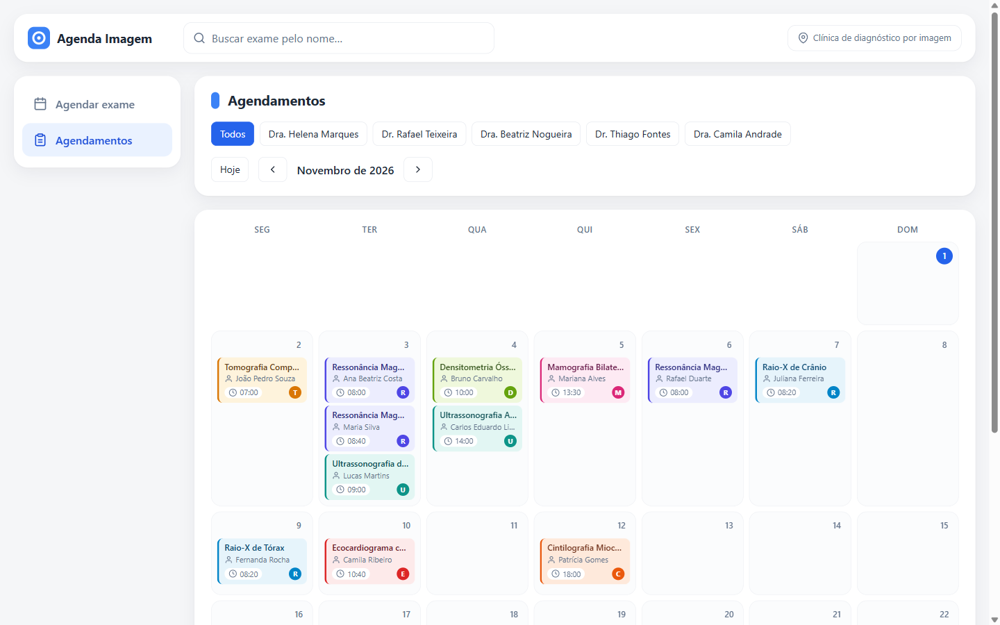
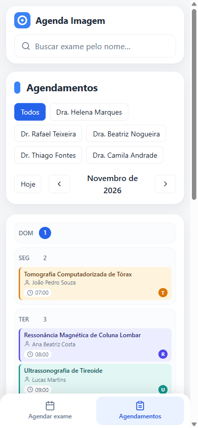

# Agendamento de Exames de Imagem

[](https://github.com/mathfrancisco/desafio-tecnico-agendamento-exames/actions/workflows/ci.yml)

Aplicação full-stack para buscar um exame, ver no calendário os dias e
horários livres de um médico, agendar e cancelar. Back-end em NestJS com
Clean Architecture, front-end em React + Vite, num monorepo.

O enunciado original está em [docs/desafio.md](docs/desafio.md).



| Agendamentos do mês | Celular |
| --- | --- |
|  |  |

## Documentação

| Documento | Conteúdo |
| --- | --- |
| [01 — Tecnologias](docs/01-tecnologias.md) | Stack, versões, arranjo do repositório e porquês |
| [02 — Arquitetura](docs/02-arquitetura.md) | Módulos, camadas, erros, controle de concorrência |
| [03 — Modelagem de dados](docs/03-modelagem-dados.md) | Entidades, schema SQLite, contrato da API |
| [04 — Regras de negócio](docs/04-regras-negocio.md) | Regras do enunciado e premissas adotadas |
| [05 — Planejamento](docs/05-planejamento.md) | Specs quebradas em cards, com critérios de aceite |
| [06 — Deploy](docs/06-deploy.md) | Imagem Docker única e passo a passo no Northflank |

## Pré-requisitos

- Node.js 20 ou superior (testado em 24) e npm.
- Nada mais: o banco é SQLite em arquivo, criado na primeira execução.

## Como rodar

Em dois terminais, a partir da raiz do repositório.

**1. API (porta 3000)**

```bash
cd backend
npm install
npm run start:dev
```

A API sobe em `http://localhost:3000/api`. Documentação Swagger em
`http://localhost:3000/api/docs` e health check em `/api/health`.
Variáveis opcionais:

| Variável | Padrão | Uso |
| --- | --- | --- |
| `PORT` | `3000` | Porta HTTP |
| `DB_PATH` | `agendamentos.db` | Arquivo SQLite (relativo a `backend/`) |
| `EXAMES_CSV_PATH` | `../dados/exames.csv` | Catálogo de exames |

**2. Front-end (porta 5173)**

```bash
cd frontend
npm install
npm run dev
```

Abra `http://localhost:5173`. O Vite encaminha `/api` para
`http://localhost:3000`, então a API precisa estar rodando nessa porta.

## Testes

```bash
cd backend
npm test            # unitários: domínio, use cases com ports falsos, adapters (94)
npm run test:e2e    # rotas HTTP, incluindo 10 pedidos concorrentes (82)
npm run test:all    # os dois
```

```bash
cd frontend
npm test            # componentes, utilitários e cliente da API (100)
```

A CI (GitHub Actions) roda lint, build e todos os testes das duas pontas em
cada push e pull request.

## Exemplos `curl`

```bash
# Buscar exames (sem acento e sem diferenciar maiúsculas)
curl "http://localhost:3000/api/exames?nome=ressonancia"

# Listar médicos e turnos
curl "http://localhost:3000/api/medicos"

# Horários livres da Dra. Helena (id 1) para Ultrassonografia Abdominal (id 7, 40 min)
curl "http://localhost:3000/api/medicos/1/horarios?data=2026-11-03&exameId=7"

# Agendar
curl -X POST "http://localhost:3000/api/agendamentos" \
  -H "Content-Type: application/json" \
  -d '{"pacienteNome":"Maria Silva","exameId":7,"medicoId":1,"inicio":"2026-11-03T08:00"}'

# Repetir o mesmo POST -> 409 (horário ocupado)

# Fora do expediente (domingo) -> 422
curl -X POST "http://localhost:3000/api/agendamentos" \
  -H "Content-Type: application/json" \
  -d '{"pacienteNome":"Maria Silva","exameId":7,"medicoId":1,"inicio":"2026-11-01T08:00"}'

# Dados inválidos -> 400
curl -X POST "http://localhost:3000/api/agendamentos" \
  -H "Content-Type: application/json" \
  -d '{"pacienteNome":"","exameId":0,"medicoId":1,"inicio":"amanha"}'

# Horários livres por dia do mês (alimenta o calendário)
curl "http://localhost:3000/api/medicos/1/disponibilidade?mes=2026-11&exameId=7"

# Agendamentos do mês (filtro opcional por médico)
curl "http://localhost:3000/api/agendamentos?mes=2026-11&medicoId=1"

# Cancelar -> 204 (404 se não existe, 422 se já começou)
curl -i -X DELETE "http://localhost:3000/api/agendamentos/1"

# Health check
curl "http://localhost:3000/api/health"
```

Ajuste as datas para dias futuros: datas no passado retornam lista vazia ou 422.

## Decisões de arquitetura (resumo)

- **Monorepo** `backend/` + `frontend/`: um clone, histórico único, contrato da
  API versionado junto com quem o consome.
- **Clean Architecture** no back-end: `domain` (regras puras) ←
  `application` (um use case por arquivo + ports) ← `infrastructure`
  (SQLite, CSV, relógio) e `http` (controllers Nest). O `app.module.ts` é a
  única raiz de composição. A regra de dependência é verificada pelo ESLint:
  importar Nest ou SQLite no domínio quebra o lint e a CI.
- **Núcleo puro**: `gerarHorarios` concentra RN2/RN4 e é usado por
  `/horarios`, `/disponibilidade` e pela validação do `POST`, então a API
  aceita exatamente o que oferece e as regras não divergem.
- **Relógio como port** (`Clock`): regra "sem passado" testável com hora fixa.
- **SQLite (better-sqlite3)**: zero instalação; transação `IMMEDIATE` com
  checagem de sobreposição antes do `INSERT` impede agendamento duplicado sob
  concorrência (há teste com 10 pedidos simultâneos).
- **Catálogos em memória**: exames lidos do CSV fornecido; médicos declarados
  em código a partir de `dados/medicos.md`.
- **Vite** no front: build simples e proxy para a API; sem SSR, sem roteador,
  sem biblioteca de estado nem UI kit (YAGNI). Calendário mensal com
  horários livres por dia, painel lateral para agendar/cancelar, cor por
  modalidade de exame e layout em lista no celular.
- **Swagger** em `/api/docs`, **health check** em `/api/health` e **CI** no
  GitHub Actions.

Detalhes em [docs/02-arquitetura.md](docs/02-arquitetura.md).

## Premissas

- Fuso único `America/Sao_Paulo`; a API troca hora local sem offset
  (`YYYY-MM-DDTHH:mm`).
- O `inicio` de um agendamento precisa estar na grade gerada a partir do
  início do turno.
- Data passada ou dia sem turno na consulta de horários retornam lista vazia.
- Nome do paciente obrigatório, 3 a 100 caracteres.

Lista completa em [docs/04-regras-negocio.md](docs/04-regras-negocio.md).

## O que ficou de fora (próximos passos)

- Autenticação e cadastro de pacientes.
- Remarcação.
- Feriados, bloqueios e pausas na agenda.
- Postgres com `EXCLUDE USING gist` para rodar várias instâncias da API.
- Testes de ponta a ponta na interface (Playwright).
